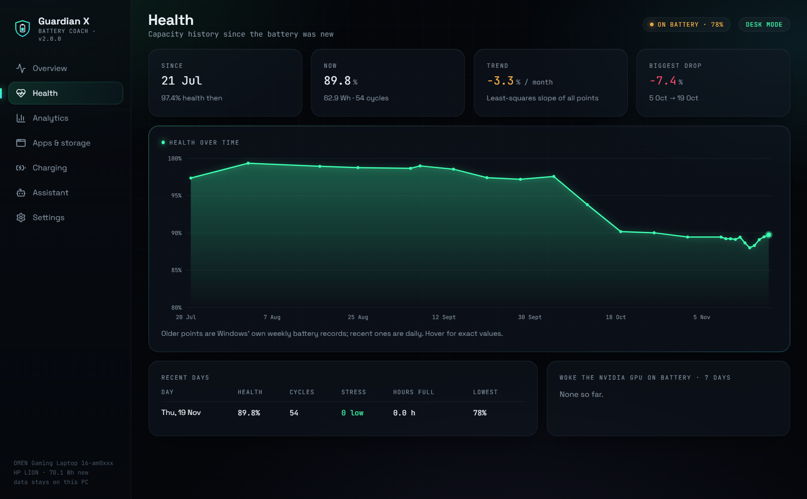
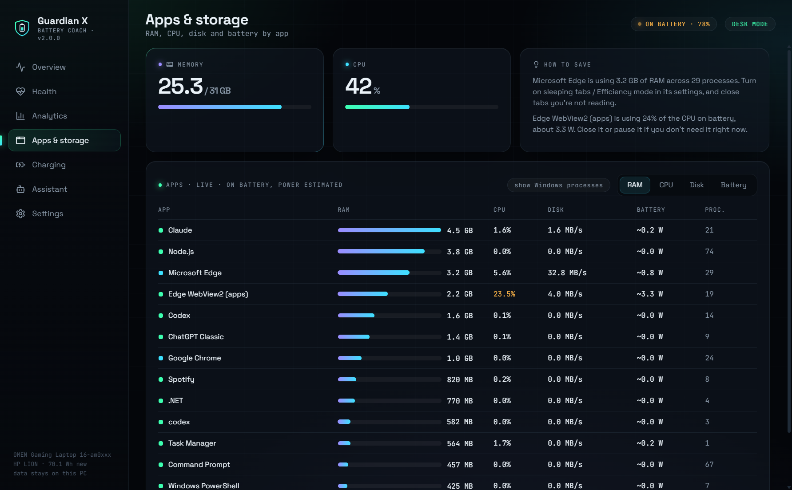
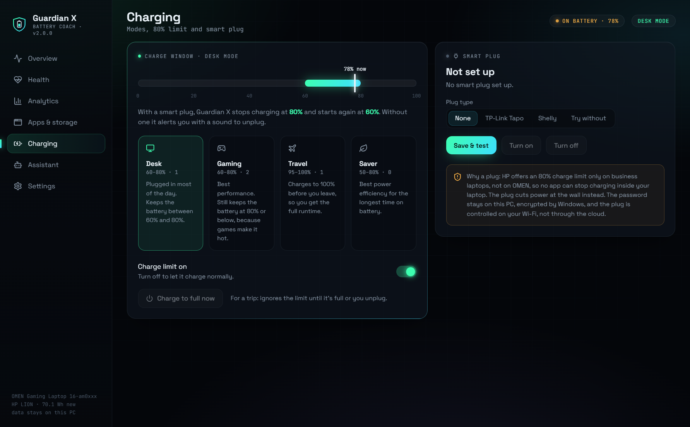
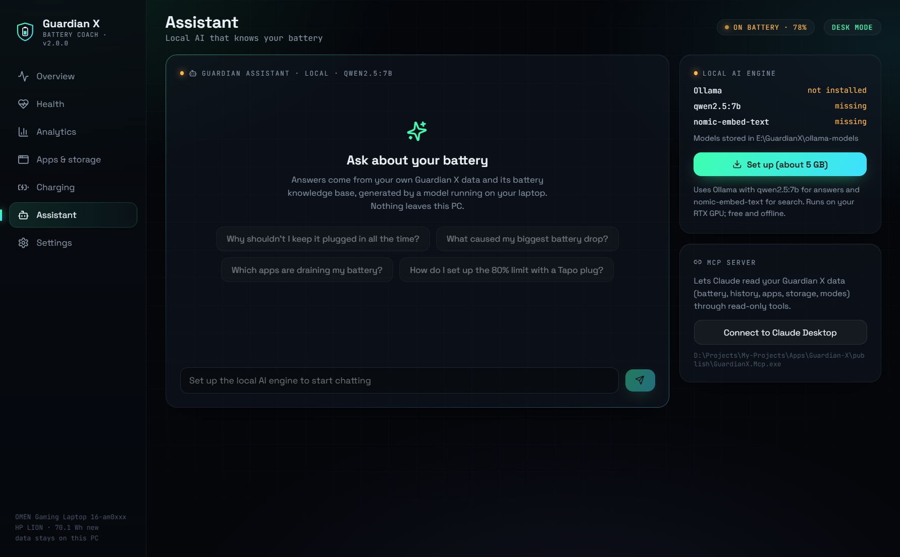

# Guardian X

A battery coach for HP OMEN gaming laptops. Windows shows you a percentage; Guardian X tells you **why your
battery is wearing out and what to change**, using the battery driver's own numbers and Windows' battery history,
then helps you change it: an 80% charge limit through a smart plug, power modes, forecasts, per-app battery use, cleanup
tools, and a built-in assistant that answers from your own data, entirely on your PC.


## What it does

| | |
|---|---|
| **Battery health** | Real capacity from the battery driver (no admin needed): health %, cycles, wear, voltage, power in watts |
| **Wear speed** | Wear per 100 cycles compared with a typical battery, so you can tell "used a lot" from "ageing badly" |
| **Day-one trend** | Imports Windows' own battery history (`powercfg /batteryreport`) back to when the battery was new, finds the biggest drop, and shows wear per month |
| **Analytics** | Where your charge level spends its time, charger vs battery hours per day, when you use the laptop, and battery energy by app |
| **Apps & storage** | Live RAM, CPU, disk and estimated battery watts for every app, with practical tips; disk space, largest apps and temp files |
| **80% charge limit** | With a TP-Link Tapo (P100/P110) or Shelly plug, Guardian X cuts the charger at your limit and turns it back on at the resume level. Without a plug it alerts you to unplug |
| **Modes** | Desk 60–80%, Gaming 60–80% with best performance, Travel to 100%, Saver 50–80% with best efficiency. Each can switch the Windows power mode |
| **Forecasts** | When health reaches 80% at your measured trend (drawn on the health chart), time to empty, full or the charge limit (with the slower top-off above 80%), and expected charge at 11 pm |
| **Auto-actions** | Switch modes when you plug in or unplug, Gaming mode while a game runs full screen, and Windows Efficiency mode for apps you choose while on battery |
| **Cleanup** | Temp files (asks first, skips files in use), Recycle Bin, a big-file finder (never deletes; opens the folder), and start-up apps you can switch off the way Task Manager does |
| **Alerts with real sounds** | Four synthesised stereo sound packs (Aurora, Crystal, Pulse, Nebula) with real reverb, at your high and low levels (80% and 20% by default), when sitting full too long, on unusual sleep drain, and when an app keeps the NVIDIA GPU awake on battery. Quiet hours silence them at night |
| **Assistant** | Chat about your battery with a retrieval-augmented assistant built into the app: it works out what you're asking, answers from your live data and history, and backs it with the matching section of its battery guides. No AI model, no download, nothing leaves the PC |
| **Reports & widget** | A weekly HTML report (health curve, forecast, day-by-day stress, battery use by app) and an always-on-top mini widget with live charge and power |
| **MCP server** | `GuardianX.Mcp.exe` gives Claude Desktop read-only tools: battery status, forecast, briefing, health history, top apps, app battery use, storage, knowledge search, modes, and asking Guardian X's assistant. One click in the Assistant page connects it |
| **Self-repair** | If its history database is ever damaged, Guardian X moves it aside and rebuilds it from every readable row on the next start |
| **Private** | Everything stays in `%LOCALAPPDATA%\GuardianXData`. No account, no telemetry. Export to CSV or delete any time |

| | |
|---|---|
|  |  |
|  |  |

## Install

1. Download `GuardianX-win-Setup.exe` from Releases and run it. No admin rights needed.
2. Guardian X opens and adds a shield icon to the tray. It starts with Windows (you can turn that off in Settings).

The interface uses Microsoft Edge WebView2, which is built into Windows 11.

**Update:** Settings > Check for updates (v1 users: the same button updates you to v2; your history is kept).
**Repair:** Settings > Repair checks the history database, settings, start-up entry, sounds, battery, GPU access and the MCP server.
**Uninstall:** Windows Settings > Apps > Installed apps > Guardian X. You're asked whether to keep your history.

## Why not keep it plugged in at 100%?

Lithium-ion batteries age fastest when they sit at a high charge and are warm. A gaming laptop on the charger all
day does exactly that: 100% charge, with the CPU and GPU heating the chassis. Keeping it between about 40% and
80% most of the time slows that ageing a lot.

HP only offers a fixed 80% charge limit on its business laptops. OMEN laptops don't have one, and no app can stop
the charging circuit inside them. So Guardian X does it at the wall: with a supported smart plug on your Wi-Fi it
switches the charger off at your limit and on again at the resume level. The plug's password is encrypted with
Windows (DPAPI) and the plug is controlled on your local network, not through a cloud service.

The Tapo and Shelly code follows the plugs' published local protocols but has only been tested against a simulated
plug so far. Choose "Try without" on the Charging page to see the limiter work with a simulated plug.

## Build from source

Needs the .NET 8 SDK on Windows, and Node 18+ for the interface.

```powershell
cd ui; npm ci; npm run build; cd ..        # builds the interface into src\GuardianX.App\wwwroot
dotnet test GuardianX.sln                  # 74 tests
dotnet run --project src\GuardianX.App     # run it
.\scripts\release.ps1 -Version 2.1.0       # installer in Releases\ (needs: dotnet tool install -g vpk)
```

`npm run dev` in `ui\` previews the interface in a browser with sample data.

Developer checks: `GuardianX.exe --selftest out.json` writes the raw battery and GPU readings;
`GuardianX.exe --snapshot out.png <page>` renders a page (overview, health, analytics, apps, charging, assistant,
settings) to an image.

## Project layout

```
src/GuardianX.Core     battery driver reader, Windows history import, SQLite store, insights, GPU watcher,
                       app monitor, modes, sounds, smart plugs and charge limiter, RAG assistant
src/GuardianX.App      WPF host: WebView2 interface, bridge to the engine, tray, Velopack install/update/uninstall
src/GuardianX.Mcp      MCP server (stdio) for Claude Desktop
ui/                    React + TypeScript interface (Vite, framer-motion)
tests/GuardianX.Tests  xUnit tests for the battery maths, history import, store, limiter, plugs, knowledge search
```

## Licence

MIT, see [LICENSE](LICENSE).
