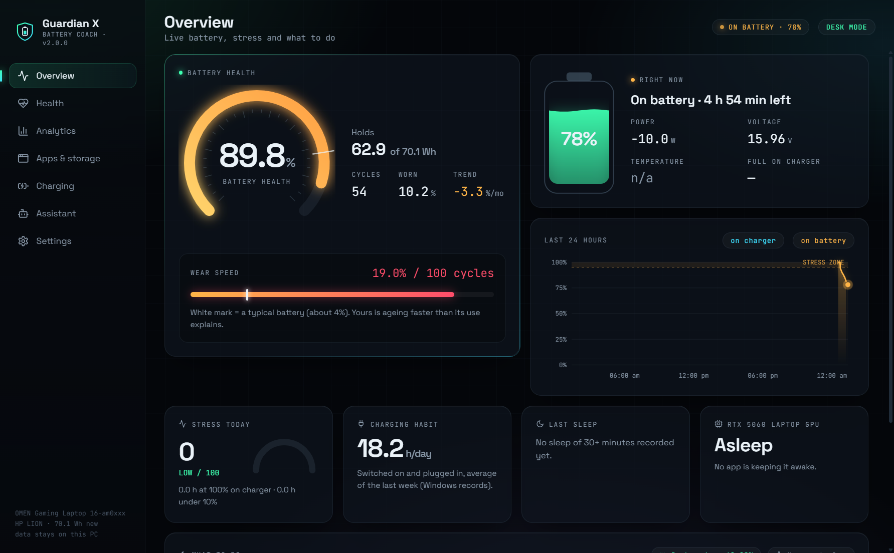
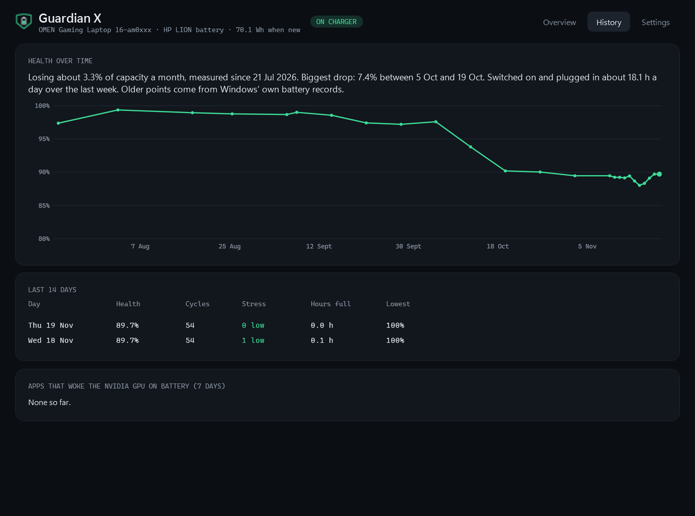

# Guardian X

A battery coach for HP OMEN gaming laptops. Windows shows you a percentage; Guardian X tells you **why your
battery is wearing out and what to change**, using the battery driver's own numbers and Windows' battery history.



## What it does

| | |
|---|---|
| **Battery health** | Real capacity from the battery driver (no admin needed): health %, cycles, wear |
| **Wear speed** | Wear per 100 cycles compared with a typical battery, so you can tell "used a lot" from "ageing badly" |
| **Day-one trend** | Imports Windows' own battery history (`powercfg /batteryreport`) back to when the battery was new, finds the biggest drop, and shows wear per month |
| **Stress score** | Daily 0–100 score from time spent full on the charger, nearly empty, and hot (where the battery reports temperature) |
| **Charging coach** | Alerts when the laptop has sat at 100% on the charger too long, and how many hours a day it's plugged in |
| **Sleep drain** | Battery lost during each sleep, flagged when it's unusual for your laptop |
| **NVIDIA GPU watch** | On battery, names apps that keep the RTX GPU awake (read from Windows' GPU counters, which doesn't wake the GPU) |
| **Private** | Everything stays in `%LOCALAPPDATA%\GuardianXData`. No account, no telemetry. Export to CSV or delete any time |



## Install

1. Download `GuardianX-win-Setup.exe` from Releases and run it. No admin rights needed.
2. Guardian X opens and adds a shield icon to the tray. It starts with Windows (you can turn that off in Settings).

**Update:** Settings > Check for updates.
**Repair:** Settings > Repair checks the history database, settings, start-up entry, battery and GPU access.
**Uninstall:** Windows Settings > Apps > Installed apps > Guardian X. You're asked whether to keep your history.

## About the 80% charge limit

HP only offers a fixed 80% charge limit on its business laptops. OMEN laptops have **Adaptive Battery Optimizer**
instead, which watches battery temperature, charge and usage and steps in by itself. Make sure it's on: restart,
press F10, open Configuration, set Adaptive Battery Optimizer to Enabled, save with F10. Since there's no hard cap,
unplugging when you're not gaming is the biggest win, and Guardian X tells you when the laptop has sat full too long.

## Build from source

Needs the .NET 8 SDK on Windows.

```powershell
dotnet test GuardianX.sln                 # 20 tests
dotnet run --project src\GuardianX.App    # run it
.\scripts\release.ps1 -Version 1.0.0      # installer in Releases\ (needs: dotnet tool install -g vpk)
```

Developer checks: `GuardianX.exe --selftest out.json` writes the raw battery and GPU readings;
`GuardianX.exe --snapshot out.png [overview|history|settings]` renders a screen to an image.

## Project layout

```
src/GuardianX.Core     battery driver reader, Windows history import, SQLite store, insights, GPU watcher
src/GuardianX.App      WPF app: tray, dashboard, settings, Velopack install/update/uninstall
tests/GuardianX.Tests  xUnit tests for the battery maths, history import and store
```

## Roadmap

- **v2** Android app showing the laptop's battery over Wi-Fi
- **v3** Runtime prediction and unusual-drain detection
- **v4** Battery-health forecast and "Ask Guardian", answered offline from your own data

## Licence

MIT, see [LICENSE](LICENSE).
